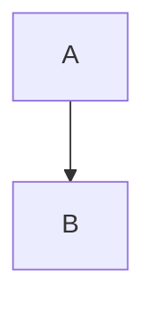
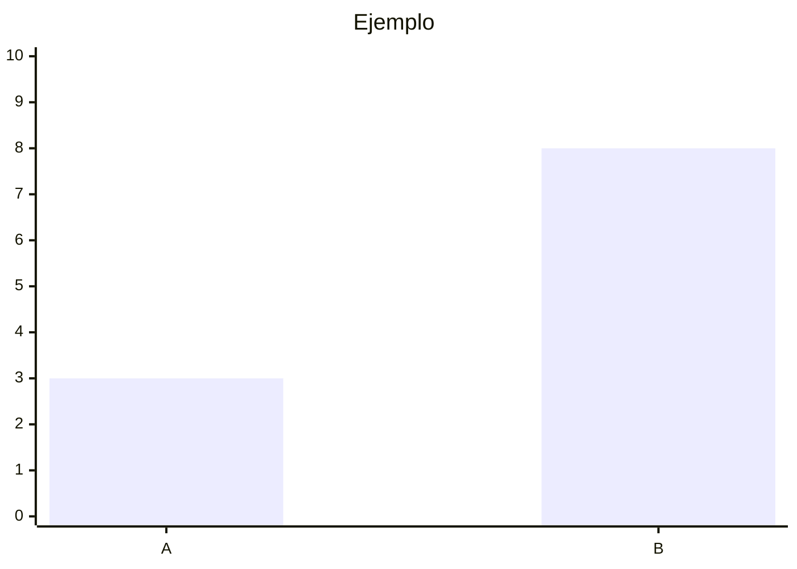

# Cómo publicar un post

Todo es **Markdown** (`.md`). Sin HTML ni MDX.

1. Pon la portada (opcional) en `public/blog/` como `.webp` liviano.
2. Crea un archivo `.md` en `src/content/posts/`.
3. Frontmatter:

```yaml
---
title: 'Mi título'
description: 'Una línea clara'
pubDate: 2026-10-26
tags: ['indie', 'notas']
heroLabel: Seguridad
cover: /blog/mi-cover.webp
coverAlt: Descripción corta de la imagen
---
```

4. Escribe el cuerpo en Markdown normal.
5. Diagramas y gráficos con Mermaid:

````md

````

````md

````

6. `draft: true` oculta el post.

Tip: el `slug` de la URL es el nombre del archivo (sin `.md`).
