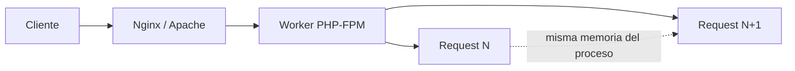
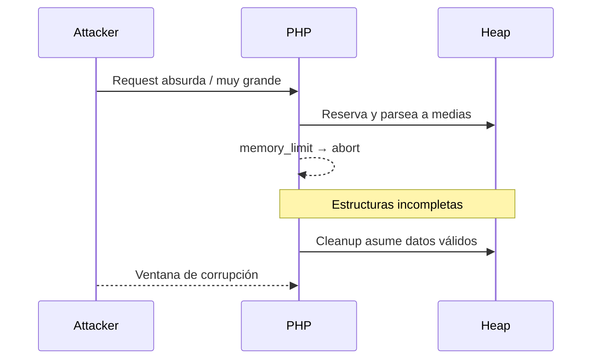
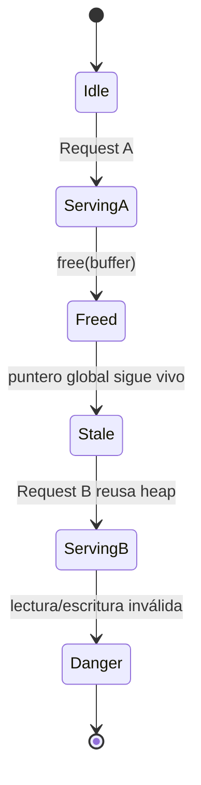
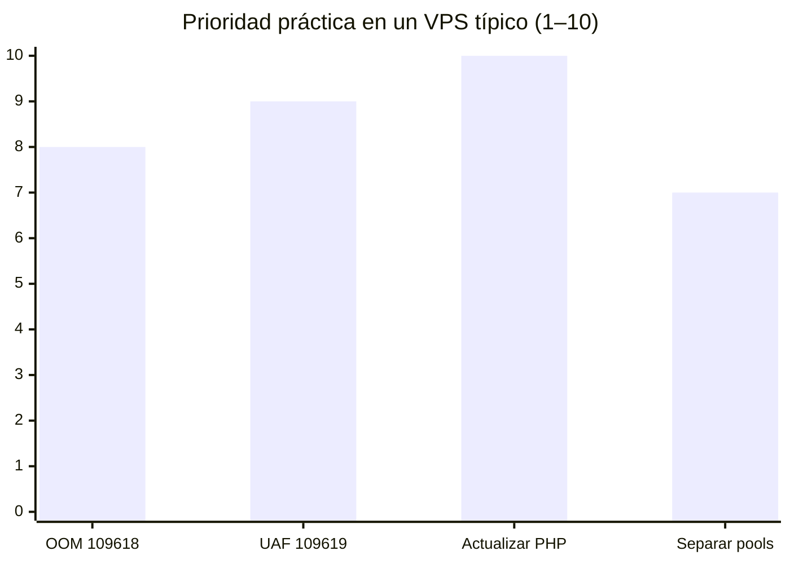

Hoy me senté a leer dos reportes que, si escribes PHP de verdad (no solo “hola mundo” en local), te deberían hacer fruncir el ceño. No vengo a vender pánico ni a tirar un PoC. Vengo a traducir el lío a lenguaje de quien mantiene un VPS a las 2 a.m.

Los dos vectores tienen nombres largos, pero la idea es simple:

1. **CVE-2026-109618**: el proceso se queda sin memoria a mitad de armar la request y PHP limpia basura como si fuera oro.
2. **CVE-2026-109619**: el worker reutiliza procesos y se queda con un puntero “viejo” a memoria ya liberada.

Si te suena abstracto, sigue. Lo bajo a tierra.

## El contexto que casi nadie escribe en el CVE

PHP en producción casi nunca es “un proceso por request y adiós”. Con **PHP-FPM** (o SAPIs parecidos) tienes un pool de workers. Cada worker atiende request A, luego B, luego C… sin reiniciar el proceso cada vez.

Eso es buenísimo para rendimiento. También significa que **cualquier estado global mal limpiado** puede cruzar de un usuario a otro. Ahí vive el drama del segundo CVE.

## CVE-2026-109618: cuando el OOM corta a mitad de camino

### Qué pasa, en humano

Imagina que estás armando una maleta. Alguien te corta la luz cuando vas a la mitad. Luego llega otra persona, ve la maleta abierta y asume que todo adentro es válido. Saca lo que hay… aunque sea un calcetín a medias y un cable enredado.

En PHP, una request maliciosa (muchos campos, headers absurdos, body gigante) puede empujar el proceso hacia el **`memory_limit`**. PHP aborta el parseo. Parte de las estructuras internas quedan **a medio inicializar**. En el cleanup, el runtime las trata como si estuvieran completas. Ahí el atacante gana una ventana para **corromper memoria** y, en el peor caso, **ejecutar código**.

No hace falta “magia”. Hace falta un cleanup que confía demasiado en invariantes rotas.

### Por qué me importa como indie

Porque muchas apps “tranquilas” viven detrás de un reverse proxy que **no** corta igual que PHP. Tú puedes tener `client_max_body_size` en Nginx y aún así recibir tormentas de headers o forms con miles de keys. El límite de memoria de PHP es el último fusible… y este bug dice que el fusible, al saltar, deja humo dentro del motor.

### Señales prácticas (sin PoC)

- Revisa `memory_limit` real en FPM, no solo en `php.ini` “global”.
- Mira si tu app parsea uploads/forms enormes sin techo propio.
- Preferir fallar **antes** (en edge/proxy) que dejar que PHP muera a mitad de request.

## CVE-2026-109619: estado global obsoleto (use-after-free de la vida real)

### Qué pasa, en humano

El worker termina la request A y libera un bloque de memoria. Pero se olvida de borrar un **apuntador global** que todavía cree que ese bloque es suyo. Llega la request B, PHP reutiliza ese hueco del heap para otra cosa… y el apuntador viejo sigue leyendo o escribiendo ahí.

Eso es el clásico **use-after-free**, vestido de SAPI reuse.

Consecuencias típicas en este diseño:

- **Leak** de datos de otro usuario (tokens, cookies, fragmentos de body).
- **Hijack** de ejecución si logras controlar qué cae en esa región liberada.

### Por qué duele más en FPM que en CLI

En CLI cada script muere con el proceso. En FPM el proceso **sigue**. El bug no es solo “hay un UAF”. Es “hay un UAF **entre vecinos** en el mismo worker”.

Si tu panel admin y tu API pública comparten pool… ya te pintaste el escenario.

## Comparando impacto (visión de ops, no de score CVSS)

El número no viene de un laboratorio. Viene de esta pregunta: **¿cuánto me cuesta no hacer nada esta semana?**

| Vector | Clase | Momento del fallo | Riesgo típico |
| --- | --- | --- | --- |
| 109618 | Cleanup tras OOM | Durante el parseo / shutdown de la request | Corrupción → RCE potencial |
| 109619 | Use-after-free / stale globals | Entre request A y B en el mismo worker | Leak cross-user → RCE potencial |

## Qué haría yo hoy (checklist indie)

1. **Parchear PHP** al build que cierre ambos CVE. Sin romanticismo.
2. **Separar pools FPM**: admin / API / cron no tienen por qué compartir workers.
3. **Endurecer el edge**: límites de body, headers, rate limit. Que el OOM sea raro.
4. **Menos estado global** en tu código. Cada `static` o singleton “clever” es un sospechoso cuando el runtime también tropieza.
5. **Observabilidad**: logs de workers reiniciados, picos de memoria, 502 en ráfaga. El ataque a veces se ve como “el server se puso raro”.

## Cierre

Estos dos CVE me recuerdan algo que aprendí a golpes: el lenguaje no solo ejecuta tu código. Ejecuta un **ciclo de vida** (parse → run → cleanup → reuse). Si ese ciclo miente en el cleanup o en el reuse, tu app hereda la mentira.

Si mantienes PHP en producción, no hace falta memorizar el identificador del CVE. Hace falta recordar la frase:

> Una request a medias no es una request. Y un worker reutilizado no es un proceso limpio.

Ahí empieza la higiene de verdad.
